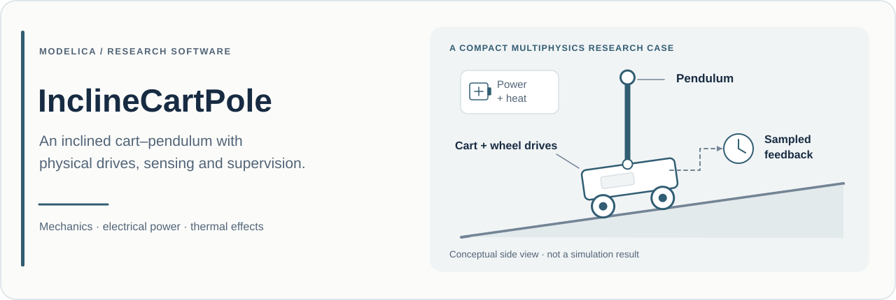
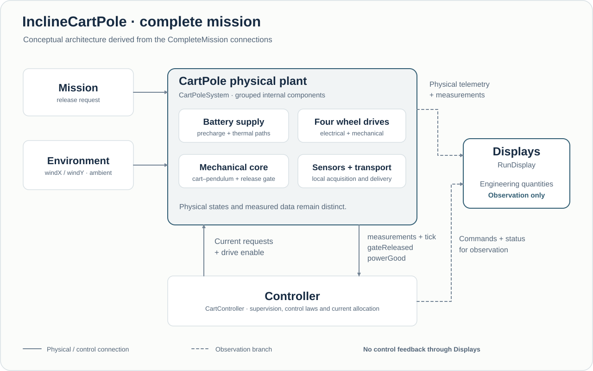

# InclineCartPole

**A compact electromechanical and thermal Modelica case for control and simulation-driven safety research.**

**English** · [简体中文](README_zh.md)

[](package.mo)
[](package.mo)

[Quick start](#quick-start) · [What to observe](#what-to-observe) · [Research use](#research-use-and-reproducibility)

## Purpose

InclineCartPole brings the mechanics of an inverted pendulum together with the equipment that makes its control possible: four separately driven wheels, a battery and precharge circuit, a physical release gate, local sensors, sampled communication and a supervisory controller. The resulting model provides a manageable setting in which to study how physical behaviour, measurement quality, control decisions and operating constraints interact.

It is intended for researchers and students working on system-level modelling, control experiments and simulation-driven safety analysis. The implementation exposes physical and signal interfaces so that an experiment can be traced from an intervention to its consequences in motion, electrical demand, temperature and control state.

## At a glance

| Item | Current source |
| :--- | :--- |
| Modelica package | `InclineCartPole` |
| GitHub repository | `InclineCartPole-MO` |
| Package version | **0.6.0**, dated 6 November 2026 in [package.mo](package.mo) |
| Declared dependency | Modelica Standard Library **4.0.0** |
| Simulation entry | [`InclineCartPole.Simulation.CompleteMission`](Simulation/CompleteMission.mo) |
| Default experiment | 0–10 s; output interval 0.01 s; tolerance `1e-6` |
| Default mechanical setting | 5° incline; 2 kg cart; 0.2 kg, 0.45 m pendulum; four driven wheels |
| Observation interface | 35 engineering quantities in [`Displays.RunDisplay`](Displays/RunDisplay.mo) |
| Source reviewed | [`d093ed7`](https://github.com/Ruizhe-Yang/InclineCartPole-MO/commit/d093ed7c7a4b3c6374844af052d579f9cb6dfd57), 12 November 2026 |

The version identifies the Modelica package. Record the Git commit as well when reproducing a study.

## How the model works



*Conceptual architecture derived from the connections in [CompleteMission.mo](Simulation/CompleteMission.mo). The physical plant contains the sensors and communication devices; the display is an observation branch.*

The single external mission action is a release request at **0.5 s**. The request energises the release mechanism; it does not directly enable the controller. Control permission depends on the actual gate state, power availability and valid, sufficiently recent measurements. The controller proceeds through waiting, kick, swing-up, capture and balance states. Loss of permission during active operation leads to a latched disabled state; the lost-balance condition can return the controller from capture or balance to swing-up. The transitions are implemented using [MSL StateGraph components](Control/LogicUnits/ModeSequence.mo).

The plant combines a planar cart–pendulum core with four wheel assemblies. Each drive includes an electrical armature circuit, an average power bridge, a current controller, gearing and thermal paths. The supply includes battery dynamics, a DC-link capacitor, precharge and voltage-based readiness logic. Bristle contact models represent wheel–ground interaction. Encoders, load cells and transport are assembled within the plant, with a default **10 ms** sampling period and **0.5 ms** delivery latency. The controller operates on these measurements; separate telemetry provides physical quantities for observation.

### Model organisation

| Package | Responsibility and useful entry |
| :--- | :--- |
| [`Simulation`](Simulation) | Mission request and complete experiment assembly |
| [`Mechanical`](Mechanical) | [Cart–pendulum dynamics](Mechanical/PlanarCore.mo), wheel assemblies, release gate and integrated plant |
| [`Electrical`](Electrical) | Battery supply, precharge, wheel drives, power conversion and associated thermal networks |
| [`Signals`](Signals) | Encoders, load cells, sampled transport and a replaceable measurement interposition point |
| [`Control`](Control) | Energy-based swing-up, balance control, mode supervision and current allocation |
| [`Environment`](Environment) | Ambient temperature and wind components |
| [`Interfaces`](Interfaces) | Commands, measurements, physical replacement boundaries and telemetry |
| [`Displays`](Displays) | Read-only motion, sensing, drive, power, contact and status panels |

## Quick start

### Open the complete experiment

Install a Modelica environment with **MSL 4.0.0**. Clone into a directory matching the Modelica package name:

```sh
git clone https://github.com/Ruizhe-Yang/InclineCartPole-MO.git InclineCartPole
cd InclineCartPole
```

Load `package.mo`, then open `InclineCartPole.Simulation.CompleteMission`. Begin with its default experiment settings. The source includes OpenModelica annotations for DASSL, a symbolic Jacobian and an initial step size of `0.00005` s. In another Modelica environment, configure the corresponding solver settings explicitly.

### Reproduce an OpenModelica run

The supplied [runner](Resources/Scripts/run_openmodelica.py) builds the model, repeats execution and records commands, source hashes, logs, MAT results and timing information:

```sh
python Resources/Scripts/run_openmodelica.py --repeat 5
```

It requires Python, an accessible `omc` executable, GCC/G++ and MSL 4.0.0. Use `--omc` to specify the compiler executable or `--msl-path` for an MSL distribution containing `Complex.mo`, `ModelicaServices` and `Modelica`. Each invocation creates a fresh build directory. The default optimised build evaluates parameters during compilation; **rebuild after changing parameters**. The `--standard` option omits parameter evaluation and link-time optimisation.

## What to observe

Open the `displays` instance, or plot variables under `displays.engineering.values`. These engineering quantities separate the physical state from the measurements and commands used in the control loop.

| Research question | Variables under `displays.engineering.values` | Interpretation |
| :--- | :--- | :--- |
| Does the pendulum approach the upright condition? | `poleAngle`, `poleRate`, `balanceActive` | Wrapped angle in degrees; zero represents upright. Read the angle and angular rate together. |
| Does the cart remain within the modelled travel? | `cartPosition`, `cartSpeed`, `tipClearance` | Position and speed along the incline; pendulum-tip clearance above the surface |
| What does the controller actually receive? | `measuredPosition`, `measuredAngle`, `dataAge`, `measurementValid` | Compare measurements with physical telemetry; data age is expressed in milliseconds. |
| Can the drives deliver the requested action? | `requestFL`, `currentFL`, and the corresponding `FR`, `RL`, `RR` quantities | Requested and actual current for each wheel |
| Is power available? | `busVoltage`, `batteryCurrent`, `socPercent`, `powerGood` | Battery current is positive on discharge; state of charge is expressed as a percentage. |
| What are the thermal and contact consequences? | `batteryTemperature`, `maxWindingTemperature`, `maxSlipVelocity`, `normalFL`–`normalRR` | Temperatures in °C; slip and wheel loads provide additional physical context. |
| Why does operation start or stop? | `mode`, `gateReleased`, `driveEnabled` | Mode 1: waiting; 2: kick; 3: swing-up; 4: capture; 5: balance; 6: disabled |

The [engineering conversion block](Displays/EngineeringValues.mo) defines the units and mappings. Displayed values are observations; they do not feed back into the controller.

## Research use and reproducibility

Establish the nominal run before introducing a controlled variation. Useful study directions include release-gate delay or jamming, encoder bias and resolution, measurement age, current tracking, supply readiness, wheel slip and thermal loading. Parameters belong to the corresponding devices. For example, [`ReleaseGate.jammed`](Mechanical/ReleaseGate.mo) represents a gate that receives its request but cannot retract.

The source also provides replaceable boundaries for the battery, gate, drive, contact and measurement path. Any replacement should preserve its connector contract and a clearly defined nominal case. Physical parameter changes should be distinguished from changes to the controller's nominal estimates.

For each experiment, record the commit, package and MSL versions, tool version, solver options, parameter modifications, initial conditions and selected outputs. Report compilation time separately from executable runtime. When citing the software, identify **Ruizhe Yang, InclineCartPole, version 0.6.0**, the repository URL and the exact revision used.

### Existing numerical evidence

The repository contains [verification records](Resources/Verification) and a [performance report](Resources/Documentation/Performance_Report.md). The archived [v0.6 acceptance timing batch](Resources/Verification/v06_acceptance_timings.json) records five successful 10 s executions with a median wall time of **1.443 s**, excluding compilation. Its [recorded environment](Resources/Verification/host_environment.json) used OpenModelica **1.25.5**, MSL **4.0.0**, GCC **14.2.0** and an AMD EPYC 9V74 processor on Linux. These are archived measurements under the recorded configuration, not a timing guarantee for other machines or a fresh validation of every subsequent source revision.

## Modelling scope

The model uses nominal engineering parameters and has not been identified against a physical cart. Its purpose is to make system interactions inspectable within stated assumptions. The planar core asserts positive wheel loads, positive pendulum-tip clearance and travel within ±1.25 m. Wheel lift, overturning and ground impact fall outside that model domain. The bristle contact and average power bridge are system-level representations; switching waveforms and detailed three-dimensional structural behaviour are outside scope.

The supplied transport requires `0 <= latency < samplePeriod`. Longer delays require a suitable queue model. The default 10 s experiment is a short transient study; thermal conclusions for longer operating periods require a separately configured experiment. Read the [physics verification notes](Resources/Documentation/Physics_Verification_zh.md) alongside any quantitative interpretation.

## Contributing

Use [Issues](https://github.com/Ruizhe-Yang/InclineCartPole-MO/issues) to report a reproducible modelling or documentation problem. Include the revision, tool version, experiment, changed parameters and relevant log or trace. Contributions that clarify physical assumptions, preserve interface contracts or improve reproducibility are particularly useful.

## Licence

The repository includes the [GNU General Public License, version 3](LICENSE). Consult the licence and any applicable upstream notices when redistributing the software.
