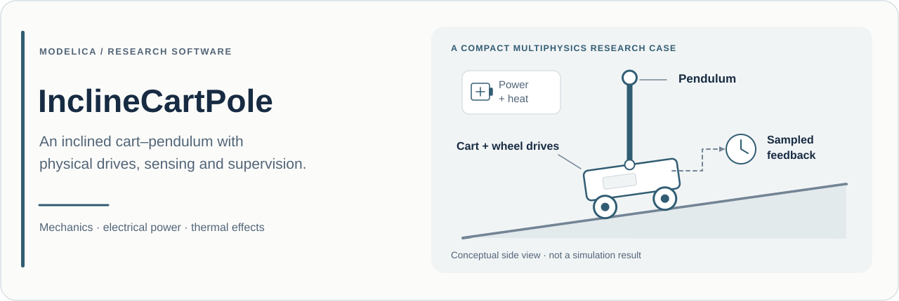
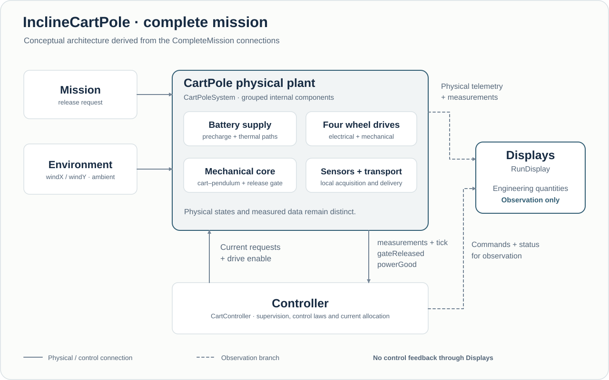

# InclineCartPole

**面向控制与仿真驱动安全研究的紧凑机电热 Modelica 案例。**

[English](README.md) · **简体中文**

[](package.mo)
[](package.mo)

## 项目目标

InclineCartPole 将倒立摆小车的机械运动与支撑其控制过程的实际设备放在同一个模型中：四个独立驱动的车轮、电池与预充电路、物理释放挡板、本地传感器、采样通信和监督控制器。模型为研究物理行为、测量质量、控制决策与运行约束的相互作用提供一个规模适中的系统级案例。

项目面向系统级建模、控制实验与仿真驱动安全分析的科研和教学使用。通过明确的物理与信号接口，可以沿着干预位置追踪运动、电气需求、温度与控制状态的变化。

## 当前版本

| 项目 | 当前源码信息 |
| :--- | :--- |
| Modelica 根包 | `InclineCartPole` |
| GitHub 仓库 | `InclineCartPole-MO` |
| 包版本 | **0.6.0**；[package.mo](package.mo) 中的版本日期为 2026-11-06 |
| 声明依赖 | Modelica Standard Library **4.0.0** |
| 仿真入口 | [`InclineCartPole.Simulation.CompleteMission`](Simulation/CompleteMission.mo) |
| 默认实验 | 0–10 s；输出间隔 0.01 s；容差 `1e-6` |
| 默认机械设置 | 5° 斜坡；2 kg 小车；0.2 kg、0.45 m 摆杆；四轮独立驱动 |
| 观测界面 | [`Displays.RunDisplay`](Displays/RunDisplay.mo) 中的 35 项工程量 |
| 说明核对基线 | [`d093ed7`](https://github.com/Ruizhe-Yang/InclineCartPole-MO/commit/d093ed7c7a4b3c6374844af052d579f9cb6dfd57)；核对日期 2026-11-12 |

包版本与 Git 提交号共同标识实验所用源码，复现研究时应同时记录。

## 模型如何运行



*根据 [CompleteMission.mo](Simulation/CompleteMission.mo) 的连接关系绘制的概念架构图。本体包含传感器和通信设备；显示模块属于观测支路。*

任务在 **0.5 s** 发出唯一的外部释放请求。请求使释放机构通电，但不直接启动控制器。控制许可由实际挡板状态、供电状态和有效且及时的测量共同决定。控制器依次经历等待、短时激励、起摆、捕获和平衡；运行期间失去许可会进入锁存禁用状态；捕获或平衡状态下触发失衡条件时可以返回起摆。状态转移由 [MSL StateGraph 元件](Control/LogicUnits/ModeSequence.mo) 实现。

物理本体由平面车摆动力学核心与四个车轮装配组成。每个驱动包含电枢电路、平均功率桥、电流控制器、减速机构和热通路。供电侧包含电池动态、直流母线电容、预充和基于电压的就绪判断。车轮与地面之间采用鬃毛接触模型。编码器、轮载传感器和传输设备均装配在本体内，默认采样周期为 **10 ms**，传输延迟为 **0.5 ms**。控制器使用这条测量链提供的信息，独立遥测则供外部观察物理状态。

### 包结构

| 包 | 职责与主要入口 |
| :--- | :--- |
| [`Simulation`](Simulation) | 任务释放请求与总体实验装配 |
| [`Mechanical`](Mechanical) | [车摆动力学](Mechanical/PlanarCore.mo)、车轮、释放挡板与本体装配 |
| [`Electrical`](Electrical) | 电池、预充、车轮驱动、功率转换与相关热网络 |
| [`Signals`](Signals) | 编码器、轮载传感器、采样传输与可替换测量插入点 |
| [`Control`](Control) | 能量起摆、平衡控制、模式监督与电流分配 |
| [`Environment`](Environment) | 环境温度与风速分量 |
| [`Interfaces`](Interfaces) | 命令、测量、物理替换边界与遥测接口 |
| [`Displays`](Displays) | 运动、感知、驱动、供电、接触和状态的只读显示 |

## 快速开始

### 打开总体实验

准备具有 **MSL 4.0.0** 的 Modelica 环境，并将仓库克隆到与根包名称一致的目录：

```sh
git clone https://github.com/Ruizhe-Yang/InclineCartPole-MO.git InclineCartPole
cd InclineCartPole
```

加载 `package.mo`，打开 `InclineCartPole.Simulation.CompleteMission`，先采用默认实验设置。源码包含 OpenModelica 的 DASSL、符号 Jacobian 和 `0.00005` s 初始步长注解；在其他 Modelica 环境中应明确设置对应求解选项。

### 复现 OpenModelica 运行

仓库提供的[运行脚本](Resources/Scripts/run_openmodelica.py)负责构建、重复执行，并保留命令、源码哈希、日志、MAT 结果与计时记录：

```sh
python Resources/Scripts/run_openmodelica.py --repeat 5
```

脚本需要 Python、可调用的 `omc`、GCC/G++ 和 MSL 4.0.0。`--omc` 可指定编译器路径，`--msl-path` 可指定包含 `Complex.mo`、`ModelicaServices` 和 `Modelica` 的标准库目录。每次运行建立新的构建目录。默认优化构建会在编译阶段求值参数，因此**修改参数后需要重新编译**；`--standard` 可关闭参数求值和链接时优化。

## 应该观察什么

打开 `displays` 实例，或绘制 `displays.engineering.values` 下的变量。工程量区分了物理状态、控制器接收的测量和驱动命令。

| 研究问题 | `displays.engineering.values` 下的变量 | 阅读要点 |
| :--- | :--- | :--- |
| 摆杆是否接近竖直平衡？ | `poleAngle`、`poleRate`、`balanceActive` | 角度归一化后以度显示，零表示竖直向上；角度与角速度应联合观察。 |
| 小车是否处于有效行程内？ | `cartPosition`、`cartSpeed`、`tipClearance` | 沿斜面的位置、速度，以及摆端相对地面的净空 |
| 控制器实际收到什么信息？ | `measuredPosition`、`measuredAngle`、`dataAge`、`measurementValid` | 对比测量与物理遥测；数据龄期单位为毫秒。 |
| 驱动是否跟踪请求？ | `requestFL`、`currentFL` 及对应的 `FR`、`RL`、`RR` 量 | 四轮请求电流与实际电流 |
| 供电是否可用？ | `busVoltage`、`batteryCurrent`、`socPercent`、`powerGood` | 电池电流以放电为正，荷电状态以百分数显示。 |
| 热与接触状态如何变化？ | `batteryTemperature`、`maxWindingTemperature`、`maxSlipVelocity`、`normalFL`–`normalRR` | 温度为 °C；滑移与法向载荷补充物理解释。 |
| 为什么启动或停止？ | `mode`、`gateReleased`、`driveEnabled` | 模式 1：等待；2：激励；3：起摆；4：捕获；5：平衡；6：禁用 |

[工程量转换模块](Displays/EngineeringValues.mo)定义单位和映射。显示值只用于观察，不参与控制反馈。

## 科研使用与复现

先建立名义运行结果，再引入受控变化。适合开展的研究包括释放延迟与卡滞、编码器偏差与分辨率、信息龄期、电流跟踪、供电就绪、轮地滑移和热负荷。参数保存在所属设备中，例如 [`ReleaseGate.jammed`](Mechanical/ReleaseGate.mo) 表示请求已经到达而挡板无法缩回。

源码还提供电池、挡板、驱动、接触和测量路径的可替换边界。替换模型应遵守接口契约，并明确定义其名义行为；物理参数变化应与控制器内部名义估计的变化分开记录。

每次实验应保存 Git 提交号、包与 MSL 版本、工具版本、求解设置、参数修改、初始条件和输出变量。构建时间与可执行文件运行时间应分别报告。引用软件时可注明 **Ruizhe Yang、InclineCartPole、0.6.0**、仓库地址及实际使用的提交号。

### 已有数值记录

仓库包含[验证记录](Resources/Verification)和[性能报告](Resources/Documentation/Performance_Report.md)。归档的 [v0.6 验收计时批次](Resources/Verification/v06_acceptance_timings.json)记录了五次成功执行的 10 s 工况，墙钟时间中位数为 **1.443 s**，不含编译。其[记录环境](Resources/Verification/host_environment.json)为 Linux、AMD EPYC 9V74、OpenModelica **1.25.5**、MSL **4.0.0** 与 GCC **14.2.0**。这是指定条件下的历史测量，不代表所有电脑都能达到同一速度，也不等于对后续每次源码修改进行了重新验证。

## 建模适用范围

模型采用名义工程参数，尚未依据实体小车进行参数辨识。平面核心通过断言检查车轮法向载荷为正、摆端净空为正，以及小车位置位于 ±1.25 m 内；车轮离地、倾覆和摆杆碰地超出了该模型的有效域。鬃毛接触与平均功率桥属于系统级表示，不包含开关波形或详细三维结构行为。

现有传输模型要求 `0 <= latency < samplePeriod`，更长延迟需要适当的队列模型。默认 10 s 实验用于短时瞬态研究；长期运行的温升结论需要另行设置实验。解释定量结果时，应同时查阅[物理验证说明](Resources/Documentation/Physics_Verification_zh.md)。

## 参与改进

通过 [Issues](https://github.com/Ruizhe-Yang/InclineCartPole-MO/issues)反馈可复现的建模或文档问题，并提供提交号、工具版本、实验入口、参数修改与日志或曲线。欢迎完善物理假设、保持接口契约及提高可复现性的贡献。

## 许可

仓库提供 [GNU General Public License 第 3 版](LICENSE)。重新分发时请查阅许可及适用的上游声明。
